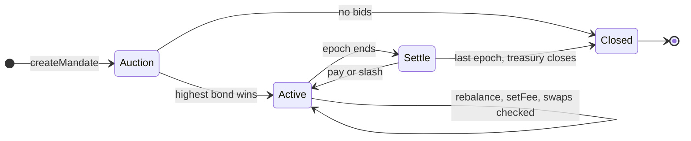
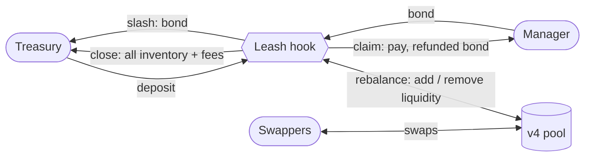

# Leash

**Hire a market maker. Keep the leash.**

Leash is a Uniswap v4 hook for onchain treasury market making. A token treasury deposits its inventory into the hook and posts a *mandate*: the rules a market maker must follow. Managers compete for the mandate by posting a first-loss bond. The winner runs the liquidity (where it sits, what fee it charges) but **can never withdraw it**. The hook checks the rules on every swap. A clean epoch pays the manager; a breach slashes the bond to the treasury.


> Built for the Uniswap Hook Incubator (UHI), cohort 11. Target chain: Unichain Sepolia.
> This is work in progress. See [Status](#status) for what exists today and what is still being built.

---

## The problem

A token project usually holds most of its treasury in its own token. Turning some of it into stablecoins without crashing the price is hard:

- **Dumping on the market** moves the price against you.
- **OTC deals** sell at a discount, usually to someone who will dump it anyway.
- **Hiring a market maker** means handing over custody and trusting reports you can't verify.

Leash makes market making and diversification the same trade. The treasury's tokens sit in a Uniswap pool and are sold only into real buy demand, at a pace the treasury sets. A professional manager runs the position, but the funds stay in a contract the manager can't drain.

## How it works

### The cast

| Role | What they do |
|---|---|
| **Treasury** | Deposits token + stablecoin, sets the mandate terms, and is the only party that can take the inventory out (when the mandate ends). |
| **Manager** | Wins the mandate by posting the highest bond. Moves the liquidity between price ranges and sets the swap fee, within the mandate's limits. |
| **Swappers and arbitrageurs** | Trade against the pool. Their trades are the buy demand the treasury sells into. Arbitrage keeps the pool's price in line with other markets. |
| **Leash hook** | Holds the inventory, owns the LP position, records prices, checks every swap, and pays or slashes at the end of each epoch. |

### Lifecycle



1. **Post a mandate.** The treasury calls `createMandate` with a pool key, a starting price, the terms and the inventory. The hook creates the pool itself, sets the fee to the mandate's cap, pulls in the tokens and places the treasury's opening position, so the pool is never empty.
2. **Bond auction.** Until `auctionEnd`, managers call `bid` with a bond in the stablecoin. Each bid must beat the current one. An outbid bond goes straight into the bidder's claimable balance.
3. **Active epochs.** The winning manager calls `rebalance` to move the liquidity (never below the depth floor) and `setFee` to tune the fee. Swappers trade against the pool. On every swap, and whenever a keeper calls `checkpoint`, the hook records the price and books the time since the last check as in or out of compliance.
4. **Settle each epoch.** When an epoch ends, anyone can settle it, in order (the keeper does this automatically). If the position stayed in compliance long enough, the manager earns a share of the swap fees the position earned. If not, the bond is slashed to the treasury.
5. **Close.** After the last epoch, the treasury calls `close`. The hook pulls the liquidity out of the pool and sends all inventory, plus any fees earned, back to the treasury. The manager claims the remaining bond.

### Where the money can go

The whole design rests on one property: **inventory only ever moves between the hook and the pool, except when it goes back to the treasury.**



The manager has exactly two verbs, `rebalance` and `setFee`. Neither takes a recipient address. No function sends inventory to the manager. The only things a manager ever receives are their own bond back and their pay, both through `claim`.

The hook keeps a **per-mandate ledger** (`idle0`, `idle1`) of inventory held outside the position. A rebalance that would need more than that mandate's inventory reverts, even when the hook's total balance could cover it (for example, using the manager's own bond or another mandate's funds). The tests check this directly.

### The real attack: mispricing, not withdrawal

Blocking withdrawals is the easy part. A manager who wants to steal can do it through prices instead:

1. Pull the treasury's liquidity out of the pool. The pool is now nearly empty.
2. Push the pool price down with a tiny swap. That's cheap, because there's no liquidity.
3. Put the treasury's liquidity back around that fake low price.
4. Buy the treasury's tokens cheaply from another wallet.

Nothing was withdrawn, yet the treasury lost money. Leash blocks this with a **TWAP** (time-weighted average price) that the hook records itself:

- **Rebalance guard.** Liquidity can only be placed while the pool price is close to the TWAP. A price pushed for one block is far from the average, so the rebalance reverts.
- **Anchor: liquidity at every price.** At creation the treasury places a permanent full-range position that the manager can never move. With no empty price range, moving or holding the price anywhere costs capital and invites arbitrage. Without it, the price outside the treasury's range could be parked for free and the TWAP dragged.
- **No sandwiches.** At most one rebalance per block, none after the price has moved in that block, a minimum range width around the TWAP, a fee floor, and the position may only grow while spot sits at the TWAP. A manager who nudges the price and re-ranges behind it pays more in fees than it can extract.
- **Truncated oracle.** Each recorded price may move at most 50 ticks (about 0.5%) per second. A real crash shows up within a minute or so, but a price parked for one block moves the 30-minute TWAP by a few ticks at most.
- **Grief guard.** Compliance is measured against the TWAP, not the current price. An outsider can't knock the price out of range for one block to get the manager slashed.

v4 has no built-in oracle, so the hook stores its own price observations. It records one in `beforeSwap`, at the first swap of each block, using the price *before* that swap (the same approach as Uniswap v3's oracle). Moving the price and moving it back within one block leaves no trace in the TWAP.

### What gets checked on every swap

| Rule | Measured as | Why |
|---|---|---|
| **In range** | The TWAP is inside the manager's liquidity range. | Liquidity out of range isn't making a market. |
| **Depth** | The position's liquidity is at or above the mandate's floor (`minLiquidity`). | A market maker has to provide real depth, not a token position. |
| **Pace** | The stablecoin share of the inventory stays at or under a glide path toward the target mix. | Diversify at the treasury's pace. Selling faster than the schedule is dumping. |
| **Fee** | The fee is at or under the cap. | Enforced when the fee is set, so it can never be breached. |

**Compliance is counted in time, not swaps.** At every check (each swap, each manager action, and a public `checkpoint()` that the keeper calls every minute) the hook books the seconds since the previous check. An interval counts as compliant only if the mandate was compliant at **both** ends, so a manager can't wait out a bad stretch and log it as good once the price drifts back. With a keeper running, the booking is accurate to about one check interval each time the state changes. An epoch is breached only if its out-of-compliance time exceeds the mandate's allowance, so a single bad block can't slash anyone.

### Why the pool is treasury-only

`beforeInitialize` and `beforeAddLiquidity` revert for everyone except the hook. The hook's own calls skip its hooks: v4-core's `Hooks.sol` doesn't call a hook for actions the hook itself triggers. So:

- Only the hook can create a Leash pool, and every Leash pool has a mandate.
- Nobody else can add liquidity, so the pool's book is exactly the treasury's position. Depth and inventory mix are read directly, not estimated.

### Fees

Leash pools are created with v4's dynamic-fee flag. The fee starts at the mandate's cap. Only the hook can change it, through `poolManager.updateDynamicLPFee`, and only when the manager calls `setFee` with a value at or under the cap.

## Mandate terms

`Terms` in [src/Leash.sol](src/Leash.sol):

| Term | Meaning |
|---|---|
| `stableIs0` | Which pool currency is the stablecoin. Bonds are paid in it. |
| `maxFee` | Fee cap in hundredths of a basis point (v4 "pips"). |
| `auctionEnd` | When bidding closes and epoch 0 starts. Must be at least one TWAP window away, so the oracle has full history before the manager can act. |
| `epochLength`, `epochs` | Epoch duration in seconds, and how many epochs there are (at most 104). |
| `minBond` | Smallest acceptable bond. |
| `twapWindow` | Seconds the TWAP averages over. |
| `maxTickDeviation` | A rebalance is refused while spot is more than this many ticks from the TWAP (100 ticks ≈ 1%). |
| `minLiquidity` | Depth floor: the position can never be smaller. |
| `uptimeBps` | Share of each epoch that must be in compliance, e.g. 9500 = 95%. |
| `managerFeeBps` | Manager's share of a clean epoch's LP fees, e.g. 3000 = 30%. |
| `startStableBps`, `endStableBps` | Pace glide path: the highest stablecoin share of inventory value allowed, from epoch 0 to the end, linear in between. |
| `minFee` | Fee floor. With `maxFee`, the manager sets the fee inside this band, so manipulation round trips always cost. |
| `minHalfWidth` | The managed range must reach at least this many ticks either side of the TWAP, with spot strictly inside. Must exceed `maxTickDeviation`. |
| `anchorLiquidity` | A permanent full-range position the manager can never move, so there is liquidity at every price (see below). |

## Status

Hookathon deadline is 3 December 2026.

| Piece | State |
|---|---|
| Mandates: hook-created treasury-only pool, deposit, opening position | ✅ |
| Bond auction with pull-payment refunds (`bid`, `claim`) | ✅ |
| Hook-owned liquidity, manager `rebalance`, per-mandate ledger | ✅ |
| Capped dynamic fee (`setFee`) | ✅ |
| Hook-recorded TWAP and the rebalance guard | ✅ |
| Per-swap compliance, time-in-compliance accounting, public `checkpoint` | ✅ |
| Epoch settlement: pay or slash, manager track record | ✅ |
| `close`: settles remaining epochs, returns everything | ✅ |
| Invariant fuzzing: ledger always matches balances; managers gain only their pay | ✅ |
| Deploy script, local dev chain, keeper | ✅ |
| Landing page (React + TypeScript) | ✅ |
| Independent security audit: 2 critical, 1 high, 2 medium, 1 low found and fixed; each attack kept as a regression test | ✅ |
| Re-audit of the fixes | 🔨 in progress |
| Unichain Sepolia deployment (source verified) | ✅ |
| App screens: create a mandate, bid, manage, dashboard | ⏳ |

### Known limits

- **Arbitrage keeps the price honest.** The pool holds only the treasury's liquidity, so its price tracks the wider market only as well as arbitrageurs link the two.
- **The TWAP assumes arbitrage.** If nobody trades the pool back toward the market, holding a price costs nothing and any TWAP can be dragged. The anchor turns holding into a cost: keeping the price X ticks away for one block costs about (anchor + managed liquidity in the path) × (X/20000)², paid to the arbitrageur who trades it back. Dragging the TWAP means paying that every block for a whole window. The cost grows with the anchor's size, with blocks per window and with the square of the distance. Size the anchor and `minLiquidity` so dragging costs far more than a bond, or than what a manager could extract around a fake price. In the audit's test setup (12-second blocks, anchor about 20% of value), dragging cost 3–8× what it could extract, and forcing an honest manager's breach cost 68× the bond. On 1-second blocks each figure is about 12× higher.
- **Managers can't deepen during trends.** While spot is off the TWAP they can re-range at the same or smaller size; growing the position waits until the TWAP catches up.
- **ERC-20 only.** Native ETH pools are rejected.
- **One mandate per pool.** One hook serves many pools.
- **Oracle history is fixed at 1,024 observations** (one per block with a swap). A pool swapped every block on 1-second blocks keeps about 17 minutes, and longer windows quietly shorten to what's held. A growable buffer, as in Uniswap v3, would lift this.
- **Fast trends.** While spot runs far from the TWAP, rebalances are refused, and out-of-range time counts against the manager. The uptime allowance is the only slack.
- **Fees are booked when collected.** A late settle counts some of the next epoch's fees toward the earlier one; the keeper settles promptly.
- **Quiet pools need the keeper.** Without checkpoints, a long gap is judged only by its endpoints, and the first swap after a gap spanning many epochs pays to book them all (about 23k gas per epoch).
- **Standard ERC-20s only.** Fee-on-transfer and rebasing tokens are not supported.

## Deployments

| Network | Leash hook | PoolManager |
|---|---|---|
| Unichain Sepolia (1301) | [`0x2D01f25225D8CF9AD416d466472b2d8Bf7Dd2880`](https://unichain-sepolia.blockscout.com/address/0x2D01f25225D8CF9AD416d466472b2d8Bf7Dd2880) (source verified) | `0x00B036B58a818B1BC34d502D3fE730Db729e62AC` |

The address ends in `0x2880`: v4 reads a hook's permissions from its address bits, here before-initialize, before-add-liquidity and before-swap.

## Repository layout

```
src/Leash.sol              the hook: mandates, auction, liquidity, TWAP, compliance, settlement
src/utils/BaseHook.sol     vendored v4 BaseHook (periphery at this pin no longer ships it)
test/Leash.t.sol           unit tests
test/fuzz/                 invariant tests: ledger == balances, managers gain only their pay
test/Deploy.t.sol          the deployed hook address encodes exactly its permissions
test/Settle.t.sol          keeper logic
test/audit/                the audit's attacks, each asserting it now fails
script/DeployLeash.s.sol   mines the hook address and deploys (Unichain Sepolia or any chain)
script/Local.s.sol         local stack: v4, mock tokens, Leash and a seeded mandate
script/Settle.s.sol        keeper round: checkpoint, then settle ended epochs
scripts/local.sh           one command: fresh anvil with everything deployed
scripts/keeper.sh          runs the keeper every minute
deployments/               addresses per chain, and the ABI for the frontend
frontend/                  landing page (Vite + React + TypeScript)
frontend/cutout.swift      rebuilds the hero's animation layers from the source art (macOS)
```

## Running it

Contracts (Foundry):

```sh
git clone --recurse-submodules https://github.com/minrawsjar/Leash
cd Leash
forge test
```

Local chain with everything deployed and a live mandate (accounts: #0 treasury, #1 and #2 managers, #3 swapper, #4 keeper):

```sh
./scripts/local.sh                      # anvil at http://127.0.0.1:8545; addresses in deployments/31337.json
./scripts/keeper.sh                     # in a second terminal: checkpoint and settle every 60s
cast rpc evm_increaseTime 600 && cast rpc evm_mine   # skip time
```

Unichain Sepolia (put `PRIVATE_KEY` in `.env`, see `.env.example`):

```sh
forge script script/DeployLeash.s.sol --rpc-url unichain_sepolia --broadcast
```

Frontend:

```sh
cd frontend
npm install
npm run dev      # local dev server
npm run build    # typecheck + production build into frontend/dist
```

Add `?t=2.4` to the page URL to freeze the hero animation at that second.

