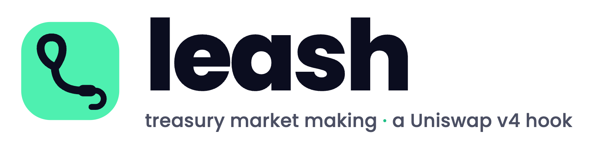
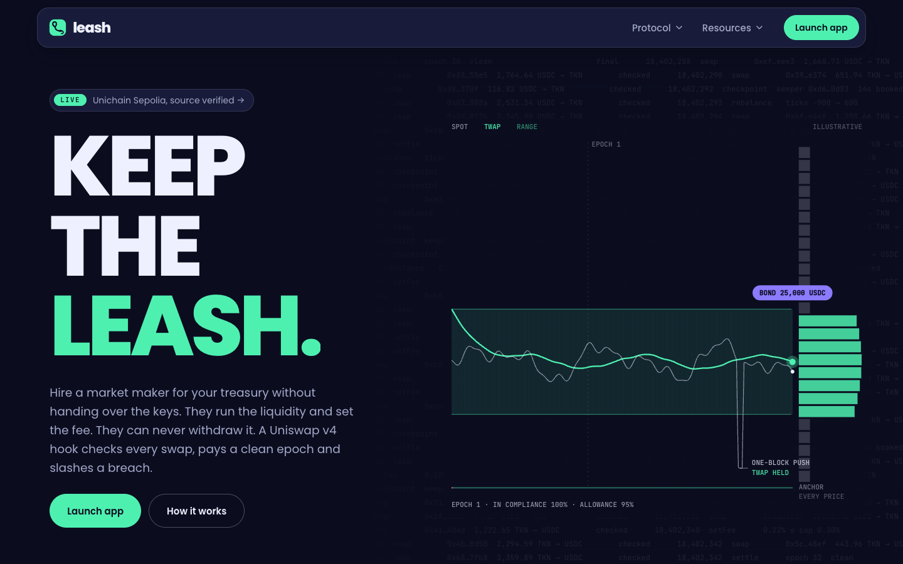

<div align="center">

<picture>
  <source media="(prefers-color-scheme: dark)" srcset="docs/wordmark-dark.png">
  
</picture>

### Hire a market maker. Keep the leash.

[](src/README.md)
[](https://unichain-sepolia.blockscout.com/address/0xbB07E2C8C163063C602A2D00ddc97d5FacE76880)
[](test/README.md)
[](#what-leash-is-live-today)

**Leash is a Uniswap v4 hook that lets a token treasury hire a market maker without handing over its inventory.** The treasury deposits into the hook and posts a *mandate*, the rules a market maker must follow:
- managers compete for the mandate by posting a first-loss bond;
- the winner runs the liquidity (where it sits, what fee it charges) but **can never withdraw it**;
- the hook checks the rules on every swap;
- a clean epoch pays the manager; a breach slashes the bond to the treasury, in proportion to how long the rules were broken.

It's live on Unichain Sepolia, built for the Uniswap Hook Incubator, cohort 11 (UHI11).

[**Open the app**](https://leash-khaki.vercel.app/app) · [Landing page](https://leash-khaki.vercel.app) · [Verified hook on Blockscout](https://unichain-sepolia.blockscout.com/address/0xbB07E2C8C163063C602A2D00ddc97d5FacE76880) · [The contract, in full](src/README.md) · [Every audit finding](test/audit/README.md)


</div>

---

> **In one paragraph.**
> - **Custody:** the hook holds the inventory and owns the LP position. The manager's two verbs, `rebalance` and `setFee`, take no recipient; it receives only its pay and its own bond, through `claim`.
> - **Pricing:** the real attack is mispricing, not withdrawal. A hook-recorded, truncated TWAP, a permanent full-range anchor and per-rebalance guards make every step of it cost more than it returns.
> - **Rules:** in range, deep enough, on pace, judged against the TWAP and counted in seconds, not swaps.
> - **Settlement:** per epoch, anyone can settle and earns a small bounty from the treasury's fee share. A clean epoch pays the manager a share of the fees; a breach slashes part of the bond to the treasury, all of it at twice the allowance.
> - **Fees:** every swap pays the manager's fee plus a surcharge that grows with the distance between spot and the TWAP, so pushing the price costs more the further it goes.
> - **On chain:** the hook (23,792 bytes) and one linked oracle library (2,489 bytes), no owner, admin, pause or upgrade path. Deployed and source verified on Unichain Sepolia.
> - **Tests:** 72 forge tests in 6 suites, including three invariants over 12,800 random calls each, and every attack from two internal review rounds kept as a test that now fails to profit.

## Contents

1. [Why treasuries need this](#why-treasuries-need-this)
2. [What Leash is, live today](#what-leash-is-live-today)
3. [The life of a mandate](#the-life-of-a-mandate)
4. [How the hook keeps the leash](#how-the-hook-keeps-the-leash)
5. [Mandate terms](#mandate-terms)
6. [Hard problems we solved](#hard-problems-we-solved)
7. [The numbers](#the-numbers)
8. [Deployment addresses](#deployment-addresses)
9. [Proof: run it yourself](#proof-run-it-yourself)
10. [Threat model, and what we don't claim](#threat-model-and-what-we-dont-claim)
11. [Repository map](#repository-map)
12. [Roadmap](#roadmap)

---

## Why treasuries need this

A token project usually holds most of its treasury in its own token. Turning some of it into stablecoins without crashing the price is hard:

- **Dumping on the market** moves the price against you.
- **OTC deals** sell at a discount, usually to someone who will dump it anyway.
- **Hiring a market maker** means handing over custody and trusting reports you can't verify.

Leash makes market making and diversification the same trade. The treasury's tokens sit in a Uniswap pool and are sold only into real buy demand, at a pace the treasury sets. A professional manager runs the position, but the funds stay in a contract the manager can't drain.

## What Leash is, live today



### The cast

| Role | What they do |
|---|---|
| **Treasury** | Deposits token + stablecoin, sets the mandate terms, and is the only party that can take the inventory out (when the mandate ends). |
| **Manager** | Wins the mandate by posting the highest bond. Moves the liquidity between price ranges and sets the swap fee, within the mandate's limits. |
| **Swappers and arbitrageurs** | Trade against the pool. Their trades are the buy demand the treasury sells into. Arbitrage keeps the pool's price in line with other markets. |
| **Keeper** | Anyone. Calls `checkpoint` every minute and settles ended epochs, so quiet stretches are judged and payouts happen on time. Whoever settles earns 10 bps of the treasury's share of that epoch's fees. |
| **Leash hook** | Holds the inventory, owns the LP position, records prices, checks every swap, and pays or slashes at the end of each epoch. |

### What's built

Built for the UHI11 Hookathon (deadline 3 December 2026). Everything below is done:

| Piece | Where |
|---|---|
| Mandates: hook-created treasury-only pool, deposit, opening position | [`src/Leash.sol`](src/Leash.sol) |
| Bond auction with pull-payment refunds (`bid`, `claim`) | `Leash.sol` |
| Hook-owned liquidity, manager `rebalance`, per-mandate ledger | `Leash.sol` |
| Capped dynamic fee (`setFee`), plus a per-swap surcharge when spot is off the TWAP | `Leash.sol` |
| Hook-recorded TWAP and the rebalance guard | `Leash.sol` |
| Per-swap compliance, time-in-compliance accounting, public `checkpoint` | `Leash.sol` |
| Epoch settlement: pay, or a slash proportional to the time out; manager track record | `Leash.sol` |
| Keeper bounty on `settle`, paid from the treasury's fee share | `Leash.sol` |
| Bond floor: `minBond` at least 2% of the deposit's value (`ThinBond`) | `Leash.sol` |
| TWAP oracle as an external linked library | [`src/LeashOracle.sol`](src/LeashOracle.sol) |
| `close`: settles remaining epochs, returns everything | `Leash.sol` |
| Invariant fuzzing: ledger always matches balances; managers gain only their pay; bonds and balances are conserved | [`test/fuzz/`](test/README.md) |
| Deploy script, local dev chain, keeper | [`script/`](script/README.md), [`scripts/`](scripts/README.md) |
| Security review (internal, not a third-party audit): 2 critical, 1 high, 2 medium, 1 low found and fixed; each attack kept as a regression test | [`test/audit/`](test/audit/README.md) |
| Re-audit of the fixes: 1 high, 2 medium, 2 low found; fixed or bounded and documented under [Known limits](#known-limits), each kept as a test | [`test/audit/`](test/audit/README.md) |
| Unichain Sepolia deployment (source verified) | [Deployment addresses](#deployment-addresses) |
| Landing page: animated mandate hero, five-scene scroll story (React + TypeScript) | [leash-khaki.vercel.app](https://leash-khaki.vercel.app), [`frontend/src/site/`](frontend/src/site/README.md) |
| App at `/app` (viem): mandates, live dashboard, create with a rules backtester, bid, manager console, keeper panel, a `#/managers` leaderboard, settle and claim; writes checked by `frontend/src/app/verify.ts` on anvil | [leash-khaki.vercel.app/app](https://leash-khaki.vercel.app/app), [`frontend/src/app/`](frontend/src/app/README.md) |
| AI mandate drafter: plain words in, a filled form out; it signs nothing | [`frontend/api/`](frontend/api/README.md) |

## The life of a mandate


1. **Post a mandate.** The treasury calls `createMandate` with a pool key, a starting price, the terms and the inventory. The hook creates the pool itself, sets the fee to the mandate's cap, pulls in the tokens and places the treasury's opening position, so the pool is never empty.
2. **Bond auction.** Until `auctionEnd`, managers call `bid` with a bond in the stablecoin. Each bid must beat the current one. An outbid bond goes straight into the bidder's claimable balance. If nobody bids, the treasury can close from `auctionEnd`.
3. **Active epochs.** The winning manager calls `rebalance` to move the liquidity (never below the depth floor) and `setFee` to tune the fee. Swappers trade against the pool. On every swap, and whenever a keeper calls `checkpoint`, the hook records the price and books the time since the last check as in or out of compliance.
4. **Settle each epoch.** When an epoch ends, anyone can settle it, in order (the keeper does this automatically). If the position stayed in compliance long enough, the manager earns a share of the swap fees the position earned. If not, part of the bond is slashed to the treasury: bond × (time out − allowance) / allowance. Out for twice the allowance or more (or out at all under 100% uptime) takes the whole bond and fires the manager. Whoever settles, other than the treasury, earns 10 bps of the treasury's share of that epoch's fees.
5. **Close.** After the last epoch, the treasury calls `close`. The hook pulls the liquidity out of the pool and sends all inventory, plus any fees earned, back to the treasury. The manager claims the remaining bond.

## How the hook keeps the leash

### Where the money can go

The whole design rests on one property: **inventory only ever moves between the hook and the pool, except when it goes back to the treasury.**


The manager has exactly two verbs, `rebalance` and `setFee`. Neither takes a recipient address. No function sends inventory to the manager. The only things a manager ever receives are their own bond back and their pay, both through `claim`.

The hook keeps a **per-mandate ledger** (`idle0`, `idle1`) of inventory held outside the position. A rebalance that would need more than that mandate's inventory reverts, even when the hook's total balance could cover it (for example, using the manager's own bond or another mandate's funds). The tests check this directly.

### The real attack: mispricing, not withdrawal

Blocking withdrawals is the easy part. A manager who wants to steal can do it through prices instead:

1. Pull the treasury's liquidity out of the pool. The pool is now nearly empty.
2. Push the pool price down with a tiny swap. That's cheap, because there's no liquidity.
3. Put the treasury's liquidity back around that fake low price.
4. Buy the treasury's tokens cheaply from another wallet.

Nothing was withdrawn, yet the treasury lost money.


Leash blocks this with a **TWAP** (time-weighted average price) that the hook records itself:

- **Rebalance guard.** Liquidity can only be placed while the pool price is close to the TWAP. A price pushed for one block is far from the average, so the rebalance reverts.
- **Anchor: liquidity at every price.** At creation the treasury places a permanent full-range position that the manager can never move. With no empty price range, moving or holding the price anywhere costs capital and invites arbitrage. Without it, the price outside the treasury's range could be parked for free and the TWAP dragged.
- **No sandwiches.** At most one rebalance per block, a minimum range width around the TWAP and a fee floor. The position may only grow while spot sits at the TWAP, never after the price moved in that block, and by at most 5% per TWAP window. A manager who nudges the price and re-ranges behind it at the same size meets the same liquidity both ways, so it pays fees for nothing.
- **Truncated oracle.** Each recorded price may move at most 50 ticks (about 0.5%) per second. A real crash shows up within a minute or so, but a price parked for one block moves the 30-minute TWAP by a few ticks at most.
- **Grief guard.** Compliance is measured against the TWAP, not the current price. An outsider can't knock the price out of range for one block to get the manager slashed, and a one-tick nudge can't veto a repair: only growth needs an unmoved block.
- **Anchor floor.** `createMandate` refuses an anchor worth less than about 20% of the deposit. A thinner one made the drag attack below pay.
- **Off-TWAP surcharge.** Every swap pays the manager's fee plus 10 pips per tick that spot is more than 10 ticks from the TWAP, capped at `maxFee` (1% off the TWAP adds 0.09%). Holding the price away now costs fees on top of the capital it ties up.

v4 has no built-in oracle, so the hook stores its own price observations, in the linked library [`LeashOracle.sol`](src/LeashOracle.sol). It records one in `beforeSwap`, at the first swap of each block, using the price *before* that swap (the same approach as Uniswap v3's oracle). Moving the price and moving it back within one block leaves no trace in the TWAP.

### What gets checked on every swap

| Rule | Measured as | Why |
|---|---|---|
| **In range** | The TWAP is inside the manager's liquidity range. | Liquidity out of range isn't making a market. |
| **Depth** | The position's liquidity is at or above the mandate's floor (`minLiquidity`). | A market maker has to provide real depth, not a token position. |
| **Pace** | The stablecoin share of the inventory stays at or under a glide path toward the target mix. | Diversify at the treasury's pace. Selling faster than the schedule is dumping. |
| **Fee** | The fee is at or under the cap. | Enforced when the fee is set, and the per-swap surcharge is capped at `maxFee`, so it can never be breached. |

**Compliance is counted in time, not swaps.** At every check (each swap, each manager action, and a public `checkpoint()` that the keeper calls every minute) the hook books the seconds since the previous check. An interval counts as compliant only if the mandate was compliant at **both** ends, so a manager can't wait out a bad stretch and log it as good once the price drifts back. With a keeper running, the booking is accurate to about one check interval each time the state changes. An epoch is breached only if its out-of-compliance time exceeds the mandate's allowance, so a single bad block can't slash anyone, and the slash grows with how far over the allowance it went.

### Why the pool is treasury-only

`beforeInitialize` and `beforeAddLiquidity` revert for everyone except the hook. The hook's own calls skip its hooks: v4-core's `Hooks.sol` doesn't call a hook for actions the hook itself triggers. So:

- Only the hook can create a Leash pool, and every Leash pool has a mandate.
- Nobody else can add liquidity, so the pool's book is exactly the treasury's position. Depth and inventory mix are read directly, not estimated.

### Fees

Leash pools are created with v4's dynamic-fee flag. The fee starts at the mandate's cap. Only the hook can change it, through `poolManager.updateDynamicLPFee`, and only when the manager calls `setFee` with a value at or under the cap (and at or above the floor, `minFee`).

On top of that, `beforeSwap` overrides each swap's fee: the manager's fee plus 10 pips for every tick spot is more than 10 ticks from the TWAP, capped at `maxFee`. A swap at the TWAP pays exactly the manager's fee; a swap that trades against a pushed price pays more. Tests: `test_dynamicFee_*`.

## Mandate terms

`Terms` in [src/Leash.sol](src/Leash.sol), fixed at creation:

| Term | Meaning |
|---|---|
| `stableIs0` | Which pool currency is the stablecoin. Bonds are paid in it. |
| `maxFee` | Fee cap in hundredths of a basis point (v4 "pips"). |
| `auctionEnd` | When bidding closes and epoch 0 starts. Must be at least one TWAP window away, so the oracle has full history before the manager can act. |
| `epochLength`, `epochs` | Epoch duration in seconds, and how many epochs there are (at most 104). |
| `minBond` | Smallest acceptable bond. Must be at least 2% of the deposit's value at the opening price (`ThinBond`). |
| `twapWindow` | Seconds the TWAP averages over. |
| `maxTickDeviation` | A rebalance is refused while spot is more than this many ticks from the TWAP (100 ticks ≈ 1%). |
| `minLiquidity` | Depth floor: the position can never be smaller. |
| `uptimeBps` | Share of each epoch that must be in compliance, e.g. 9500 = 95%. The rest is the allowance the partial slash is measured against. |
| `managerFeeBps` | Manager's share of a clean epoch's LP fees, e.g. 3000 = 30%. |
| `startStableBps`, `endStableBps` | Pace glide path: the highest stablecoin share of inventory value allowed, from epoch 0 to the end, linear in between. |
| `minFee` | Fee floor. With `maxFee`, the manager sets the fee inside this band, so manipulation round trips always cost. |
| `minHalfWidth` | The managed range must reach at least this many ticks either side of the TWAP, with spot strictly inside. Must exceed `maxTickDeviation`. |
| `anchorLiquidity` | A permanent full-range position the manager can never move, so there is liquidity at every price (see [the attack](#the-real-attack-mispricing-not-withdrawal)). |

Every bound `createMandate` checks, and the error each one raises, is in [src/README.md](src/README.md#mandate-terms).

## Hard problems we solved

| Problem | What we did |
|---|---|
| **v4 has no oracle**, and a hook that trusts spot can be fooled for the price of one swap. | The hook keeps its own: a 1,024-slot ring per pool, one observation per block in `beforeSwap`, from the **pre-swap** tick (as v3 does), so a push and return inside a block never enters the TWAP. Each recorded tick moves at most 50 ticks per second. `test_safe_oracleWraparoundMatchesReference` drives 1,200 swaps across the wraparound and matches a brute-force reference at every query. |
| **A hook's permissions are its address.** | `DeployLeash` reads the flags from `getHookPermissions()` on Leash's own runtime code, then `HookMiner` tries CREATE2 salts (up to 500,000; one address in 2¹⁴ matches) until the low 14 bits are exactly `0x2880`: `beforeInitialize`, `beforeAddLiquidity`, `beforeSwap`. `test_hookAddressEncodesExactlyItsPermissions` checks the bits and runs v4-core's own `Hooks.validateHookPermissions`. |
| **The real theft is mispricing**: pull, push, re-place, buy. No withdrawal needed. | The full-range anchor puts liquidity at every price; `rebalance` is refused while spot is off the TWAP (`SpotOffTwap`); the range must cover TWAP ± `minHalfWidth`. Pushing to `MAX_TICK` through the anchor overflows `int128`, so the original attack can't even be expressed (audit C-2). |
| **Sandwiching the treasury through `rebalance`**: zero fee, 60-tick range, push and re-place in one block (audit C-1). | A fee floor (`minFee`), a minimum width, one rebalance per block, no growth after an in-block move, growth only within 2 ticks of the TWAP, and the off-TWAP surcharge on the push. A same-size re-range stays legal because both legs meet the same liquidity. The same-block loop now costs the manager 0.123 tokens over 20 loops (0.060 before the surcharge). |
| **Griefing an honest manager into a breach** with one-block spikes (audit H-1), or vetoing every repair with a one-tick nudge (re-audit Medium-1). | Compliance is judged on the TWAP, so three spikes leave it at most 4 ticks off and the epoch clean. Only growth needs an unmoved block, so 0 of the nudged repairs were vetoed. Holding the range edge for 110 minutes does force a breach, at 677 tokens against a 10-token bond. |
| **Dragging the TWAP**: hold the price off for a whole window, then re-place around the dragged average (C-2, re-audit Medium-2). | The anchor makes holding cost about (anchor + managed liquidity in the path) × (X/20000)² per block, paid to arbitrageurs, and `createMandate` refuses an anchor under 19% of the deposit (`ThinAnchor`). The off-TWAP surcharge adds fees on every dragging block: a 600-tick drag now costs 18.20 tokens (16.58 before). The drag costs 53 to 349 times what it can then extract, because growth is capped at 5% per window. |
| **Growing at a stale TWAP** right after a real market move (re-audit High-1). | `GROW_BPS`: at most 5% growth per rebalance, once per TWAP window. The remaining damage is bounded and pinned by tests; see [Known limits](#known-limits). |
| **A bad stretch whitewashed** by checkpointing only once the TWAP drifted back. | An interval counts in only if the mandate was compliant at both ends; `test_checkpoint_whitewashAttemptBooksTheBadStretchOut` books the stretch out anyway. |
| **`beforeSwap` can't unlock the PoolManager**, so fees can't be collected inside a swap. | Fees are collected whenever the hook touches the position. Pre-hire fees are swept to the treasury on the first checkpoint, rebalance or settle after `auctionEnd`, and the anchor's fees never pay the manager. |
| **The per-transaction gas cap**: `close` after 365 unsettled epochs needed more than 2²⁴ gas (audit L-1). | `MAX_EPOCHS = 104` (two years of weekly epochs). Close with 104 unsettled epochs measures 8,610,615 gas. |
| **A phantom deposit**: solmate's `SafeTransferLib` treats a call to an address without code as a successful transfer (audit M-1). | `createMandate` requires code at both currencies. Native ETH is rejected with it. |
| **A clean manager's bond held hostage** by a treasury that never closes (audit M-2). | Settling the last epoch clean credits the bond to the manager's `owed` balance. All payouts are pull payments, so a reverting recipient can't block a bid, a settle or a close. |
| **The 24,576-byte contract limit (EIP-170)**, with every rule in one contract. Leash sat at 24,510 bytes, 66 under, with no room for the per-swap fee, partial slash and keeper bounty. | The oracle moved into an external linked library, [`LeashOracle.sol`](src/LeashOracle.sol) (2,489 bytes). Leash is now 23,792 bytes, 784 under, with the new features in. `forge build --sizes` runs in CI and fails if a change pushes it over. |
| **All-or-nothing slashing** treated a manager 1 minute over the allowance like one who abandoned the pool, and the fast-trend limit below cost honest managers the whole bond. | A partial slash: bond × (time out − allowance) / allowance, the whole bond and firing only at twice the allowance (or any time out under 100% uptime). The honest manager in the four-swing volatility test now loses 3.61 of a 10-token bond and keeps the mandate. |
| **Nobody is paid to settle**, so on a quiet pool payouts and slashes wait for the parties themselves. | Whoever calls `settle` earns 10 bps of the treasury's share of that epoch's fees, never from the manager's pay or bond. None when the treasury settles (including inside `close`), and none for `checkpoint`, which could be farmed. |
| **Public RPCs lag and rate-limit.** Right after an approval, the node that answers a simulation can be a block behind and report `TRANSFER_FROM_FAILED`; Blockscout's log API rate-limited and read as "no events". | The app retries a simulation that fails on allowance up to five more times, 1.5 s apart, after an approval. It falls back across three public RPCs (2 retries each), batches reads through Multicall3, and scans events incrementally with `eth_getLogs`, stepping 1,000 blocks when a node caps the range. |
| **OpenRouter's grammar limit.** The drafter's first response schema (one `{ value, why }` object per field) was refused as "compiled grammar is too large". | A flat schema: every field is one top-level number. The draft fills the form and goes through the same `plan()` checks as typed input; it signs nothing. |

## The numbers

Only measured values. Sources: `forge build --sizes`, `forge test`, `forge coverage`, and the `-vv` logs of [`test/audit/`](test/audit/README.md).

| | |
|---|---|
| Runtime bytecode | Leash **23,792 bytes**, 784 under the EIP-170 limit of 24,576; `LeashOracle` library 2,489 bytes |
| Tests | **72 passed**, 0 failed, 0 skipped, in 6 suites: unit 44, audit 13, re-audit 8, invariants 3, deploy 2, keeper 2 |
| Invariants | 3: the ledger matches balances; managers gain only their pay; bonds and balances are conserved (after every claim the hook holds exactly idle + fees + the posted bond, and the keeper is owed exactly its bounties). 128 runs × 100 calls each |
| Coverage | `src/Leash.sol`: 100% lines, 99.52% statements, 95.83% branches, 100% functions. `src/LeashOracle.sol`: 100% on all four |
| `close` with 104 unsettled epochs | **8,610,615 gas** (EIP-7825 cap: 16,777,216) |
| First swap after a quiet gap over 104 epochs | **2,534,163 gas** (about 23k per epoch booked) |
| Oracle | 1,024 observations; about 17 minutes on 1-second blocks swapped every block |
| Oracle truncation | 50 ticks per second; a one-block spike moves a 30-minute TWAP at most 4 ticks |
| Swap gas | First swap in a block 118,269 (110,245 before the surcharge); second swap 69,717 (62,566) |
| Off-TWAP surcharge | 10 pips per tick beyond 10 ticks from the TWAP, capped at `maxFee`; 1% off adds 0.09% |
| Keeper bounty | 10 bps of the treasury's share of a settled epoch's fees |
| Bond floor | 2% of the deposit's value at the opening price (`ThinBond`) |
| Growth cap | 5% per rebalance, once per TWAP window; about 47 windows from the depth floor to 10× |
| Anchor floor | 19% of the deposit's value (`ThinAnchor`) |
| Sandwich (C-1) | Same-block loop: manager **−0.123** over 20 loops (−0.060 before the surcharge). Strongest legal two-block cycle: −0.0029 per cycle, −0.00089 when it owns the block boundary |
| Drag then extract (C-2) | Drag cost 4.60 / 18.20 / 72.17 tokens at 300 / 600 / 1,200 ticks (4.21 / 16.58 / 65.81 before the surcharge). Cost / extracted: ~174×, ~235×, ~349×; smarter drag ~53× to ~174× |
| Forced breach (H-1), strongest legal | **677.45** tokens of cost against a **10**-token bond (~68×) |
| Informed manager at a stale price (High-1) | Treasury's extra loss **0.54** on a 10% jump, **5.28** on a 35% jump, of a 200-token inventory |
| One-tick veto (Medium-1) | **0** repairs vetoed; 420 s out of 4,320 allowed |
| Volatility against an honest manager (Low-1) | 5,880 s out against 4,320 allowed: loses **3.61** of a 10-token bond (36%), not fired |

## Deployment addresses

**Unichain Sepolia, chain 1301** (from [`deployments/1301.json`](deployments/1301.json), deployed at block 68,664,352):

| Contract | Address |
|---|---|
| **Leash** (hook, source verified) | [`0xbB07E2C8C163063C602A2D00ddc97d5FacE76880`](https://unichain-sepolia.blockscout.com/address/0xbB07E2C8C163063C602A2D00ddc97d5FacE76880) |
| **PoolManager** (Uniswap v4) | [`0x00B036B58a818B1BC34d502D3fE730Db729e62AC`](https://unichain-sepolia.blockscout.com/address/0x00B036B58a818B1BC34d502D3fE730Db729e62AC) |
| Test TKN / mUSDC (open mint, from [`deployments/1301-tokens.json`](deployments/1301-tokens.json)) | `0x2E8D07593389DDB1d84421D41e1d5fe120DCd99C` / `0xd010B2D159a9F43Ce22CDD038c7CC6BfBb2aaE3E` |

The address ends in `0x2880`: v4 reads a hook's permissions from its address bits, here before-initialize, before-add-liquidity and before-swap. How the address was mined, and the broadcast records behind it, are in [`deployments/README.md`](deployments/README.md) and [`script/README.md`](script/README.md).

**The site** is on Vercel: the landing page at [leash-khaki.vercel.app](https://leash-khaki.vercel.app), the app at [/app](https://leash-khaki.vercel.app/app), the drafter at `/api/draft`.

## Proof: run it yourself

| Check | Result |
|---|---|
| `./scripts/demo.sh` | The whole story on a fresh anvil in about 40 s: the 2% bond floor (`ThinBond`), an outbid bond refunded (`LowBid`), the mispricing rebalance refused (`SpotOffTwap`) and the same-block grow refused on chain (`SameBlock`), the off-TWAP surcharge charged (0.30% set fee becomes 0.43% at 140 ticks off), a clean epoch paying the manager 30% of fees and the keeper its bounty, a partial slash (241 s out against 180 s allowed takes 33% of the bond), and a close that leaves the hook holding nothing. Output: [`docs/demo-output.txt`](docs/demo-output.txt); video plan: [`docs/DEMO.md`](docs/DEMO.md) |
| `forge test` | 72 passed, 0 failed, 0 skipped, 6 suites |
| `forge build --sizes` | Leash 23,792 B, 784 B margin; LeashOracle 2,489 B |
| `forge test --match-path 'test/audit/*' -vv` | The 21 audit and re-audit tests, with every measured P&L and gas number |
| `forge test --match-test test_dynamicFee` | The per-swap surcharge tests |
| `forge test --match-test test_L1 -vv` | `close` with 104 unsettled epochs: 8,610,615 gas |
| `cd frontend && node api/draft.test.ts` | The drafter's error paths and request shape, with a stand-in fetch: no key, no network |
| `cd frontend && node --experimental-strip-types src/app/verify.ts` | Every app write against a fresh `./scripts/local.sh` chain, each result checked on chain |

**Contracts** (Foundry):

```sh
git clone --recurse-submodules https://github.com/minrawsjar/Leash
cd Leash
forge test
```

**Local chain** with everything deployed and a live mandate (accounts: #0 treasury, #1 and #2 managers, #3 swapper, #4 keeper):

```sh
./scripts/local.sh                      # anvil at http://127.0.0.1:8545; addresses in deployments/31337.json
RPC_URL=http://127.0.0.1:8545 ./scripts/keeper.sh   # second terminal: checkpoint and settle every 60s
cast rpc evm_increaseTime 600 && cast rpc evm_mine   # skip time
```

**Unichain Sepolia** (put `PRIVATE_KEY` in `.env`, see `.env.example`):

```sh
forge script script/DeployLeash.s.sol --rpc-url unichain_sepolia --broadcast
```

**Frontend:**

```sh
cd frontend
npm install
npm run dev      # local dev server
npm run build    # typecheck + production build into frontend/dist
```

Add `?t=2.4` to the page URL to freeze the hero animation at that second.

**Try it in two minutes:**
1. Open [leash-khaki.vercel.app/app](https://leash-khaki.vercel.app/app) with a browser wallet on Unichain Sepolia.
2. Open a mandate: its live dashboard shows spot, the TWAP and the manager's range, read from the chain.
3. Post your own under **Create**, by hand or by describing it to the AI drafter, then bid, rebalance, settle and claim from the mandate's tabs. Every write is simulated first, so a revert costs no gas.

## Threat model, and what we don't claim

| Who | What they can do | What they can't |
|---|---|---|
| **The manager** | Move the range and set the fee inside the terms; place badly on purpose (see below) | Withdraw inventory, spend the bond or another mandate's funds, profit from a sandwich or a TWAP drag in any measured configuration |
| **An outsider** | Trade the pool; push the price for a block | Breach an honest manager cheaply (it took ~68× the bond), create a Leash pool, add liquidity |
| **The treasury** | Close when the terms allow; receive a slashed bond | Keep a clean manager's bond: the last clean epoch frees it, and `close` needs the terms met |
| **The keeper** | Checkpoint and settle, in order; earn 10 bps of the treasury's fee share per settle | Change any outcome, or take from the manager's pay or bond: both calls are open to anyone and judged by the hook |
| **The deployer** | Nothing after deployment | There is no owner, admin, pause or upgrade path |

### Known limits

- **Arbitrage keeps the price honest.** The pool holds only the treasury's liquidity, so its price tracks the wider market only as well as arbitrageurs link the two.
- **The TWAP assumes arbitrage.** If nobody trades the pool back toward the market, holding a price costs nothing and any TWAP can be dragged. The anchor turns holding into a cost: keeping the price X ticks away for one block costs about (anchor + managed liquidity in the path) × (X/20000)², paid to the arbitrageur who trades it back. Dragging the TWAP means paying that every block for a whole window. The cost grows with the anchor's size, with blocks per window and with the square of the distance. Size the anchor and `minLiquidity` so dragging costs far more than a bond, or than what a manager could extract around a fake price. In the audit's test setup (12-second blocks, anchor about 20% of value), dragging the TWAP 200–1,200 ticks cost 53–349× what re-placing around it could then extract (the 5% growth cap is what keeps extraction small), and forcing an honest manager's breach cost 68× the bond. On 1-second blocks the 1,024-slot oracle holds about 17 minutes while the drag swaps every block, so the factor is about 7×, not 12×.
- **Managers deepen slowly.** Growth needs spot at the TWAP and is capped at 5% per TWAP window, so going from the depth floor to 10× takes about 47 windows. Re-ranging and shrinking are never rate-limited.
- **An informed manager can still place badly on purpose.** Nothing on-chain shows the TWAP is stale. A manager who knows of a market jump before the pool trades can re-range into its path at the old price and arbitrage the treasury itself. That looks the same as an honest re-range. The growth cap bounds it, and in the audit setup it costs the treasury about 0.3% of inventory (0.54 of 200 tokens) beyond what any arbitrageur takes on a 10% jump, and 2.6% (5.28) on a 35% jump. This is the trust that remains in any delegated LP manager; the track record and the auction price it.
- **ERC-20 only.** Native ETH pools are rejected.
- **One mandate per pool.** One hook serves many pools.
- **Oracle history is fixed at 1,024 observations** (one per block with a swap). A pool swapped every block on 1-second blocks keeps about 17 minutes, and longer windows quietly shorten to what's held. A growable buffer, as in Uniswap v3, would lift this.
- **Fast trends.** While spot runs more than `maxTickDeviation` from the TWAP, rebalances are refused, and out-of-range time counts against the manager. The uptime allowance is the only slack: in the re-audit, four 30% swings in one day put an honest manager on a ±600-tick range 98 minutes out against 72 allowed. With the partial slash that now costs 3.61 of a 10-token bond (36%) instead of all of it, and the manager is not fired. Allowing re-ranges at any gap would reopen the sandwich, so managers of volatile tokens keep wide ranges, and treasuries set `maxTickDeviation` and `uptimeBps` for the token.
- **Fees are booked when collected.** A late settle counts some of the next epoch's fees toward the earlier one; the keeper settles promptly.
- **Pre-hire sweep gap.** Fees from swaps between `auctionEnd` and the first checkpoint go to the treasury; the manager is underpaid by its share of them, never overpaid. A keeper checkpoint at `auctionEnd` closes the gap.
- **Quiet pools need the keeper.** Without checkpoints, a long gap is judged only by its endpoints, and the first swap after a gap spanning many epochs pays to book them all (about 23k gas per epoch).
- **Standard ERC-20s only.** Fee-on-transfer and rebasing tokens are not supported.
- **A big move can empty one side.** After a large price move, one side of the inventory runs out, so the manager can't place a range above the depth floor (rebalances refused as `TooShallow`) and the epoch breaches. Found with the app's rules backtester; treasuries size `minLiquidity` for the moves they expect.
- **Trends can beat the pace cap.** On long terms, a sustained trend can push the stablecoin share past the glide path whatever the manager does. Also found with the backtester.
- **Repeated misses shrink geometrically.** The partial slash takes its share from the remaining bond, so each later miss slashes less in absolute terms.
- **23,792 bytes.** 784 bytes of headroom under EIP-170, after moving the oracle into its own library.

### What we don't claim

- **Not audited by a third party.** Both review rounds were internal. Every finding is kept as a test in [`test/audit/`](test/audit/README.md), but that is not an external audit.
- **Testnet only.** The hook is deployed on Unichain Sepolia with test tokens. Nothing here has held real value.
- **The attack costs are measured, not proven.** They come from a mock 1:1 market on 12-second blocks, against an arbitrageur who restores the price first thing every block. Real arbitrage is less reliable than that.
- **The landing page's animations are illustrative** and say so. The app's numbers are read from the chain.

## Repository map

Every folder has a README index.

| Folder | What | README |
|---|---|---|
| [`src/`](src/) | The hook: mandates, auction, liquidity, compliance, settlement (`Leash.sol`), the TWAP oracle library (`LeashOracle.sol`), and the vendored v4 `BaseHook` | [README](src/README.md) |
| [`test/`](test/) | Unit tests, invariant fuzzing, the deploy and keeper tests | [README](test/README.md) |
| [`test/audit/`](test/audit/) | Every finding from the internal audit and re-audit, its attack, fix and measured numbers | [README](test/audit/README.md) |
| [`script/`](script/) | Address mining and deploy, the local stack, test tokens, the one-pool keeper round (superseded by `scripts/keeper.sh`; kept for its test) | [README](script/README.md) |
| [`scripts/`](scripts/) | `local.sh` (fresh anvil with everything deployed) and `keeper.sh` (finds every mandate from logs, checkpoints and settles each every minute) | [README](scripts/README.md) |
| [`deployments/`](deployments/) | Addresses per chain, and the ABI for the frontend | [README](deployments/README.md) |
| [`frontend/`](frontend/) | Landing page, app and AI drafter (Vite + React + TypeScript + viem) | [README](frontend/README.md) |
| [`frontend/src/app/`](frontend/src/app/) | The app at `/app`: explorer, create, dashboard, manager console, settle and claim | [README](frontend/src/app/README.md) |
| [`frontend/src/site/`](frontend/src/site/) | The landing page | [README](frontend/src/site/README.md) |
| [`frontend/api/`](frontend/api/) | `POST /api/draft`, the AI mandate drafter (OpenRouter, server-side only) | [README](frontend/api/README.md) |
| [`docs/`](docs/) | README images; the diagrams and their sources are in `docs/diagrams/` | [README](docs/README.md) |

```
src/Leash.sol              the hook: mandates, auction, liquidity, TWAP, compliance, settlement
src/LeashOracle.sol        linked library: the TWAP oracle (observe, truncate, read)
src/utils/BaseHook.sol     vendored v4 BaseHook (periphery at this pin no longer ships it)
test/Leash.t.sol           unit tests
test/fuzz/                 invariant tests: ledger == balances, managers gain only their pay, bonds conserved
test/Deploy.t.sol          the deployed hook address encodes exactly its permissions
test/Settle.t.sol          keeper logic
test/audit/                the audit's attacks, each asserting it now fails
script/DeployLeash.s.sol   mines the hook address and deploys (Unichain Sepolia or any chain)
script/Local.s.sol         local stack: v4, mock tokens, Leash and a seeded mandate
script/Settle.s.sol        one-pool keeper round (superseded by scripts/keeper.sh; kept for its test)
scripts/local.sh           one command: fresh anvil with everything deployed
scripts/keeper.sh          keeper: finds every mandate from logs, checkpoints and settles each every minute
deployments/               addresses per chain, and the ABI for the frontend
frontend/                  landing page, app and AI drafter (Vite + React + TypeScript)
docs/diagrams/             the README diagrams (PNG + SVG) and the rough.js pages that draw them (src/)
```

The diagrams are drawn by `docs/diagrams/src/*.html` with rough.js and rendered by `node docs/diagrams/src/render.mjs <page>.html <out>.png [<out>.svg]` (headless Chrome). The wordmark is `docs/diagrams/src/wordmark.html?mode=light|dark`, rendered with `--transparent`.

## Roadmap

Not built yet, and not being built for the hookathon:

- **Re-auction or renewal after a breach or at term end.** Today a breached or finished mandate can only be closed; renewing needs an epoch offset, because epoch records are keyed by index from `auctionEnd`.
- **Growable oracle cardinality.** The buffer is fixed at 1,024 observations, which holds about 17 minutes on a pool swapped every 1-second block; a v3-style growable buffer would support longer TWAP windows.
- **Chunked checkpoint and close.** One call books every epoch a gap spans, so very long gaps rely on the `MAX_EPOCHS` gas bound; booking in pieces would remove that ceiling.
- **Per-epoch fee-growth snapshots.** Fees are booked when collected, so a late settle counts later fees toward the earlier epoch; snapshotting fee growth at each epoch boundary would attribute them exactly.
- **Multi-pool mandates.** A mandate covers one pool; a treasury with several pairs has to post and watch one mandate per pool.
- **Bidding on fee share as well as bond.** Managers compete only on bond size; letting them also bid a lower `managerFeeBps` would price the mandate on both.
- **Anti-snipe auction extension.** A bid in the last seconds can't be answered; extending `auctionEnd` after a late bid would close that.
- **Breach alerts.** Treasuries and managers learn of a breach only by looking; the keeper could post to a webhook or Telegram when compliance fails or an epoch is slashed.
- **Outside-oracle sanity check for the TWAP.** On 1-second-block chains the hook's own TWAP is cheaper to drag; comparing it against an external price feed would catch a dragged price before a rebalance.
- **Safe or DAO treasury demo.** The flows are shown from an EOA; a demo with a Safe multisig or a governor as treasury would show the real target user.
