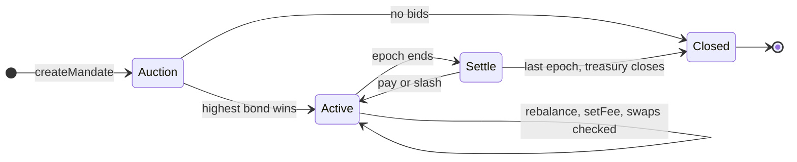

# Leash

**Hire a market maker. Keep the leash.**

Leash is a Uniswap v4 hook for onchain treasury market making. A token treasury deposits its inventory into the hook and posts a *mandate*: the rules a market maker must follow. Managers compete for the mandate by posting a first-loss bond. The winner runs the liquidity (where it sits, what fee it charges) but **can never withdraw it**. The hook checks the rules on every swap. A clean epoch pays the manager; a breach slashes the bond to the treasury.


> Built for the Uniswap Hook Incubator (UHI), cohort 11. Target chain: Unichain Sepolia.
> This is work in progress. See [Status](#status) for what exists today and what is still being built.

---

## The problem

A token project usually holds most of its treasury in its own token. Turning some of it into stablecoins without crashing the price is hard:

- **Dumping on the market** moves the price against you.
- **OTC deals** sell at a discount, usually to someone who will dump it anyway.
- **Hiring a market maker** means handing over custody and trusting reports you can't verify.

Leash makes market making and diversification the same trade. The treasury's tokens sit in a Uniswap pool and are sold only into real buy demand, at a pace the treasury sets. A professional manager runs the position, but the funds stay in a contract the manager can't drain.

## How it works

### The cast

| Role | What they do |
|---|---|
| **Treasury** | Deposits token + stablecoin, sets the mandate terms, and is the only party that can take the inventory out (when the mandate ends). |
| **Manager** | Wins the mandate by posting the highest bond. Moves the liquidity between price ranges and sets the swap fee, within the mandate's limits. |
| **Swappers and arbitrageurs** | Trade against the pool. Their trades are the buy demand the treasury sells into. Arbitrage keeps the pool's price in line with other markets. |
| **Leash hook** | Holds the inventory, owns the LP position, records prices, checks every swap, and pays or slashes at the end of each epoch. |

### Lifecycle



1. **Post a mandate.** The treasury calls `createMandate` with a pool key, a starting price, the terms and the inventory. The hook creates the pool itself, sets the fee to the mandate's cap and pulls in the tokens.
2. **Bond auction.** Until `auctionEnd`, managers call `bid` with a bond in the stablecoin. Each bid must beat the current one. An outbid bond goes straight into the bidder's claimable balance.
3. **Active epochs.** *(Compliance checks in progress.)* The winning manager calls `rebalance` to place, move or pull the liquidity, and `setFee` to tune the fee. Swappers trade against the pool. On every swap the hook records the price and updates the compliance counter for the current epoch.
4. **Settle each epoch.** *(In progress.)* When an epoch ends, anyone can settle it. If the position stayed in compliance long enough, the manager earns a share of the swap fees the position earned. If not, the bond is slashed to the treasury.
5. **Close.** After the last epoch, the treasury calls `close`. The hook pulls the liquidity out of the pool and sends all inventory, plus any fees earned, back to the treasury. The manager claims the remaining bond.

### Where the money can go

The whole design rests on one property: **inventory only ever moves between the hook and the pool, except when it goes back to the treasury.**


The manager has exactly two verbs, `rebalance` and `setFee`. Neither takes a recipient address. No function sends inventory to the manager. The only things a manager ever receives are their own bond back and their pay, both through `claim`.

The hook keeps a **per-mandate ledger** (`idle0`, `idle1`) of inventory held outside the position. A rebalance that would need more than that mandate's inventory reverts, even when the hook's total balance could cover it (for example, using the manager's own bond or another mandate's funds). The tests check this directly.

### The real attack: mispricing, not withdrawal

Blocking withdrawals is the easy part. A manager who wants to steal can do it through prices instead:

1. Pull the treasury's liquidity out of the pool. The pool is now nearly empty.
2. Push the pool price down with a tiny swap. That's cheap, because there's no liquidity.
3. Put the treasury's liquidity back around that fake low price.
4. Buy the treasury's tokens cheaply from another wallet.

Nothing was withdrawn, yet the treasury lost money. Leash blocks this with a **TWAP** (time-weighted average price) that the hook records itself:

- **Rebalance guard.** Liquidity can only be placed while the pool price is close to the TWAP. A price pushed for one block is far from the average, so the rebalance reverts.
- **Grief guard.** Compliance is measured against the TWAP, not the current price. An outsider can't knock the price out of range for one block to get the manager slashed.

v4 has no built-in oracle, so the hook stores its own price observations. It records one in `beforeSwap`, at the first swap of each block, using the price *before* that swap (the same approach as Uniswap v3's oracle). Moving the price and moving it back within one block leaves no trace in the TWAP.

### What gets checked on every swap

| Rule | Measured as | Why |
|---|---|---|
| **In range** | The TWAP is inside the manager's liquidity range. | Liquidity out of range isn't making a market. |
| **Depth** | The stablecoin it takes to move the price 2% is at least the mandate's minimum. | A market maker has to provide real depth, not a token position. |
| **Pace** | The stablecoin share of the inventory stays at or under a glide path toward the target mix. | Diversify at the treasury's pace. Selling faster than the schedule is dumping. |
| **Fee** | The fee is at or under the cap. | Enforced when the fee is set, so it can never be breached. |

**Compliance is counted in time, not swaps.** The pool's state only changes on swaps and manager actions. So on every swap the hook credits the seconds since the previous check as either in or out of compliance. This gives exact time-in-compliance for each epoch, with no keeper bot. An epoch is breached only if its out-of-compliance time exceeds the mandate's allowance. A single bad block can't slash anyone.

### Why the pool is treasury-only

`beforeInitialize` and `beforeAddLiquidity` revert for everyone except the hook. The hook's own calls skip its hooks: v4-core's `Hooks.sol` doesn't call a hook for actions the hook itself triggers. So:

- Only the hook can create a Leash pool, and every Leash pool has a mandate.
- Nobody else can add liquidity, so the pool's book is exactly the treasury's position. Depth and inventory mix are read directly, not estimated.

### Fees

Leash pools are created with v4's dynamic-fee flag. The fee starts at the mandate's cap. Only the hook can change it, through `poolManager.updateDynamicLPFee`, and only when the manager calls `setFee` with a value at or under the cap.

## Mandate terms

Implemented today (`Terms` in [src/Leash.sol](src/Leash.sol)):

| Term | Meaning |
|---|---|
| `stableIs0` | Which pool currency is the stablecoin. Bonds are paid in it. |
| `maxFee` | Fee cap in hundredths of a basis point (v4 "pips"). |
| `auctionEnd` | When bidding closes and epoch 0 starts. |
| `epochLength`, `epochs` | Epoch duration in seconds, and how many epochs there are. |
| `minBond` | Smallest acceptable bond. |

Planned, arriving with the compliance work: minimum depth, maximum TWAP deviation for rebalances, the TWAP window, the target mix and its glide path, the out-of-compliance allowance per epoch, and the manager's fee share.

## Status

Hookathon deadline is 3 December 2026.

| Piece | State |
|---|---|
| Foundry scaffold (v4-core / v4-periphery) | ✅ |
| `createMandate`: pool creation, deposit, initial fee | ✅ |
| Bond auction with pull-payment refunds (`bid`, `claim`) | ✅ |
| Hook-owned liquidity, manager `rebalance`, per-mandate ledger | ✅ |
| Capped dynamic fee (`setFee`) | ✅ |
| Treasury-only pool (outside inits and LPs blocked) | ✅ |
| `close`: return inventory and bond | ✅ |
| Landing page (React + TypeScript) | ✅ |
| TWAP observations and the rebalance guard | 🔨 next |
| Per-swap compliance and time-in-compliance accounting | ⏳ |
| Epoch settlement: pay or slash, manager track record | ⏳ |
| Fuzz test: no path lets the manager withdraw | ⏳ |
| Unichain Sepolia deployment and demo script | ⏳ |
| App screens: create a mandate, bid, manage, dashboard | ⏳ |

### Known limits

- **Arbitrage keeps the price honest.** The pool holds only the treasury's liquidity, so its price tracks the wider market only as well as arbitrageurs link the two.
- **A thin pool's TWAP can still be dragged** over many blocks by someone willing to pay for it. The TWAP window and the rebalance deviation limit bound how far.
- **ERC-20 only.** Native ETH pools are rejected.
- **One mandate per pool.** One hook serves many pools.

## Repository layout

```
src/Leash.sol            the hook: mandates, auction, liquidity, fees
src/utils/BaseHook.sol   vendored v4 BaseHook (periphery at this pin no longer ships it)
test/Leash.t.sol         Foundry tests
script/HookMiner.sol     mines a CREATE2 salt so the hook address encodes its permissions
frontend/                landing page (Vite + React + TypeScript)
frontend/cutout.swift    rebuilds the hero's animation layers from the source art (macOS)
```

## Running it

Contracts (Foundry):

```sh
git clone --recurse-submodules https://github.com/minrawsjar/Leash
cd Leash
forge test
```

Frontend:

```sh
cd frontend
npm install
npm run dev      # local dev server
npm run build    # typecheck + production build into frontend/dist
```

Add `?t=2.4` to the page URL to freeze the hero animation at that second.

